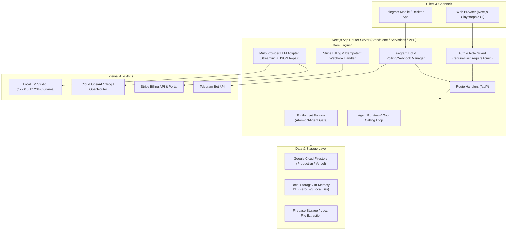

# qwenton-agents — Comprehensive Architecture & Design Specification

**Document ID:** `SPEC-2026-10-09-QWENTON-AGENTS`  
**Date:** 2026-10-09  
**Status:** Approved  
**Target Environment:** Local Development (Zero-Lag / LM Studio / Local Storage) | Production (Vercel / VPS / Cloud Firestore / Stripe / Telegram)

---

## 1. Executive Summary & Goals

**qwenton-agents** is a multi-tenant AI coworker platform built with Next.js App Router (TypeScript, Tailwind CSS), supporting both cloud production infrastructure (Firebase, Stripe, Telegram, Vercel) and instant, zero-lag local development and self-hosted VPS deployments.

### Core Objectives:
1. **Zero-Lag Local Execution:** Boot the entire application in seconds with `npm run dev`, using local LM Studio / Ollama or cloud models, and an automatic local storage fallback when Firebase cloud keys are omitted.
2. **Hard 3-Agent Entitlement:** Strict backend transaction-level enforcement preventing any user from exceeding 3 active agents across all API endpoints and race conditions.
3. **Multi-Provider LLM Engine:** Seamless dual-mode support for local LM Studio (`http://127.0.0.1:1234/v1`), Ollama (`http://localhost:11434/v1`), or production HTTPS OpenAI-compatible providers (Groq, OpenAI, OpenRouter) with structured JSON auto-repair for smaller 7B/8B models.
4. **Human-in-the-Loop Approvals:** Safe tool execution loop that automatically pauses external write operations (e.g. sending Telegram/Slack messages, emails, updating records) until explicitly approved via the Web UI or Telegram inline buttons.
5. **Production-Ready Deployments:** One-click Vercel deployment without Docker, plus standalone Node.js PM2 config (`ecosystem.config.js`) and optional multi-stage Dockerfile for VPS hosting.
6. **Tactile Claymorphism UI:** Warm, calm light palette (`#F8F6F1`), soft 3D clay cards, friendly avatars, and an observable 3-panel workspace with real-time tool execution timelines.

---

## 2. System Architecture



---

## 3. Directory & Monorepo Structure

```text
qwenton-agents/
├── app/
│   ├── (marketing)/
│   │   ├── page.tsx                       # Landing page with claymorphic hero & features
│   │   ├── pricing/page.tsx               # Public pricing cards & tier comparisons
│   │   ├── privacy/page.tsx               # Privacy policy
│   │   └── terms/page.tsx                 # Terms of service
│   ├── (auth)/
│   │   ├── login/page.tsx                 # Email/Password & Google login
│   │   ├── signup/page.tsx                # User registration
│   │   └── reset-password/page.tsx        # Password reset
│   ├── (dashboard)/
│   │   ├── dashboard/page.tsx             # Overview: 4 metric cards, active runs, telegram status
│   │   ├── agents/
│   │   │   ├── page.tsx                   # Agent list with usage counter (e.g. "2 / 3 used")
│   │   │   ├── new/page.tsx               # 4-step Agent creation wizard
│   │   │   └── [agentId]/page.tsx         # 3-panel Agent workspace (Config, Chat, Activity)
│   │   ├── conversations/page.tsx         # Conversation history list
│   │   ├── approvals/page.tsx             # Dedicated approvals inbox (amber cards, diff view)
│   │   ├── files/page.tsx                 # Knowledge & document indexing
│   │   ├── routines/page.tsx              # Scheduled automated draft reports
│   │   ├── integrations/page.tsx          # Connectors (Telegram, Slack, Drive, etc.)
│   │   ├── billing/page.tsx               # Stripe checkout, portal link, plan details
│   │   ├── settings/page.tsx              # Account, API key configs, theme
│   │   └── admin/
│   │       ├── page.tsx                   # Admin metrics & system health
│   │       ├── users/page.tsx             # User management, suspension
│   │       ├── plans/page.tsx             # Plan configs & limit adjustments
│   │       ├── subscriptions/page.tsx     # Stripe customers & active subscriptions
│   │       └── audit-events/page.tsx      # System audit logs
│   ├── api/
│   │   ├── auth/session/route.ts
│   │   ├── agents/route.ts
│   │   ├── agents/[agentId]/route.ts
│   │   ├── agents/[agentId]/archive/route.ts
│   │   ├── agents/[agentId]/restore/route.ts
│   │   ├── conversations/route.ts
│   │   ├── conversations/[conversationId]/messages/route.ts
│   │   ├── runs/[runId]/route.ts
│   │   ├── runs/[runId]/cancel/route.ts
│   │   ├── approvals/route.ts
│   │   ├── approvals/[approvalId]/approve/route.ts
│   │   ├── approvals/[approvalId]/reject/route.ts
│   │   ├── files/route.ts
│   │   ├── files/[fileId]/route.ts
│   │   ├── routines/route.ts
│   │   ├── integrations/route.ts
│   │   ├── telegram/connect/route.ts
│   │   ├── telegram/disconnect/route.ts
│   │   ├── telegram/webhook/route.ts
│   │   ├── billing/checkout/route.ts
│   │   ├── billing/portal/route.ts
│   │   ├── billing/webhook/route.ts
│   │   ├── admin/overview/route.ts
│   │   ├── admin/users/route.ts
│   │   ├── admin/plans/route.ts
│   │   └── health/route.ts
├── components/
│   ├── layout/                            # AppShell, Sidebar, Header, Breadcrumbs
│   ├── ui/                                # Tactile Claymorphism buttons, cards, dialogs, badges
│   ├── agents/                            # Wizard steps, AgentCard, TemplateSelector
│   ├── chat/                              # MessageList, MarkdownRenderer, Composer, StreamBubble
│   ├── activity/                          # Live activity timeline, tool call badges
│   ├── approvals/                         # ApprovalCard, DiffViewer, ActionConfirmationModal
│   ├── files/                             # FileUploader, KnowledgeChunkViewer
│   ├── billing/                           # PricingCard, UsageMeter, StripePortalButton
│   ├── telegram/                          # BotSetupWizard, ConnectionBadge
│   └── admin/                             # AdminMetrics, UserTable, AuditLogViewer
├── lib/
│   ├── db/                                # Abstracted Database Repository (Firestore & Local DB)
│   ├── firebase/                          # Firebase Client & Admin SDK initializers
│   ├── auth/                              # Session tokens, server-side RBAC (requireUser, requireAdmin)
│   ├── limits/                            # Entitlement enforcement & 3-agent limit transactions
│   ├── agent-runtime/                     # Step execution loop, timeout, step limits, safety bounds
│   ├── llm/                               # Multi-provider client (LM Studio, Ollama, OpenAI, Groq)
│   ├── tools/                             # Typed safe tools (Calculator, Time, WebSearch, FileReader, Reports)
│   ├── memory/                            # Conversation history, document embeddings & semantic retrieval
│   ├── telegram/                          # Telegram Bot API SDK, command router, webhook handler
│   ├── billing/                           # Stripe client, webhook signature verifier, customer mapper
│   └── validation/                        # Zod schemas for all API payloads and tool calls
├── firebase/
│   ├── firestore.rules                    # Strict user-isolation security rules
│   ├── storage.rules                      # Storage read/write rules
│   └── indexes.json                       # Firestore compound indexes
├── deploy/
│   ├── ecosystem.config.js                # PM2 config for zero-lag Node.js VPS deployment
│   └── Dockerfile                         # Optional multi-stage Docker build for containerized VPS
├── .env.example
├── next.config.ts                         # Configured with output: 'standalone'
├── package.json
└── README.md
```

---

## 4. Agent Runtime & Safe Execution Loop

### 4.1 Bounded Step Execution
1. **Context Construction:** Ingests Agent System Instructions, user query, conversation history (last 10 turns), and retrieved knowledge chunks.
2. **Step Limits:** Capped at 10 autonomous tool steps per run. Hard execution timeout of 120 seconds.
3. **Structured JSON Auto-Repair:** Automatically cleans code fences and fixes missing JSON properties for local models like Llama 3 or Qwen 2.5.
4. **SSE Streaming:** Streams tokens and lifecycle events directly to the client over Server-Sent Events (`text/event-stream`).

### 4.2 Tool Catalog & Approval Policy

| Tool Name | Permission Tier | Action Type | Human Approval Required? |
| :--- | :--- | :--- | :--- |
| `calculator` | Read-only | Evaluates safe math expressions | No |
| `current_time` | Read-only | Returns current date/time with timezone | No |
| `read_file` | Read-only | Reads extracted text from user's uploaded files | No |
| `search_knowledge` | Read-only | Performs semantic search over user document chunks | No |
| `web_research` | Read-only | Queries public search API & summarizes results | No |
| `generate_report` | Draft Write | Compiles a formatted Markdown report into conversation | No |
| `send_telegram_message`| External Write | Dispatches message to connected Telegram chat | **Yes (Paused for Approval)** |
| `send_slack_message` | External Write | Posts notification to Slack channel | **Yes (Paused for Approval)** |
| `create_calendar_event`| External Write | Creates Google Calendar draft event | **Yes (Paused for Approval)** |

---

## 5. Data Model & Hard Entitlement Enforcement

### 5.1 Collections Schema
- `users`: `uid`, `email`, `displayName`, `role` (`user` | `admin`), `planId`, `activeAgentsCount` (integer, max 3), `status` (`active` | `suspended`), `stripeCustomerId`, `createdAt`, `updatedAt`.
- `plans`: `id`, `name`, `maxAgents` (default 3), `maxRunsPerMonth`, `maxStorageBytes`, `stripePriceId`, `features`, `active`.
- `subscriptions`: `id`, `userId`, `stripeSubscriptionId`, `planId`, `status` (`active` | `trialing` | `past_due` | `canceled`), `currentPeriodEnd`.
- `billingEvents`: `id`, `eventId`, `type`, `data`, `processedAt` (Used for webhook idempotency).
- `agents`: `id`, `ownerUid`, `name`, `role`, `description`, `systemPrompt`, `status` (`active` | `paused` | `archived`), `enabledTools`, `telegramBotId`, `createdAt`, `updatedAt`.
- `conversations`: `id`, `ownerUid`, `agentId`, `title`, `lastMessageAt`, `createdAt`.
- `messages`: `id`, `conversationId`, `sender` (`user` | `agent` | `system`), `content`, `attachments`, `createdAt`.
- `runs`: `id`, `conversationId`, `agentId`, `ownerUid`, `status` (`running` | `waiting_for_approval` | `completed` | `failed`), `totalSteps`, `startedAt`, `completedAt`.
- `approvals`: `id`, `runId`, `agentId`, `ownerUid`, `actionType`, `targetService`, `payload`, `riskLevel` (`low` | `medium` | `high`), `status` (`pending` | `approved` | `rejected`), `createdAt`, `decidedAt`.
- `files`: `id`, `ownerUid`, `fileName`, `storageUrl`, `sizeBytes`, `status` (`ready` | `indexing` | `failed`), `createdAt`.
- `documentChunks`: `id`, `fileId`, `ownerUid`, `chunkIndex`, `text`, `embedding`.
- `telegramConnections`: `id`, `ownerUid`, `botUsername`, `assignedAgentId`, `status` (`connected` | `error` | `disconnected`), `lastTestedAt`.
- `auditEvents`: `id`, `actorUid`, `action`, `resource`, `details`, `ipAddress`, `createdAt`.

### 5.2 Atomic 3-Agent Limit
Enforced directly within database transactions. If `activeAgentsCount >= plan.maxAgents` (3), agent creation throws an `EntitlementError (403)` immediately. Archiving an agent decrements the counter atomically, freeing a slot.

---

## 6. Stripe Subscriptions & Telegram Integration

### 6.1 Stripe Billing Flow
- Server-side raw buffer webhook handler at `/api/billing/webhook` with cryptographic signature verification (`stripe.webhooks.constructEvent`).
- Idempotent processing with `billingEvents` deduplication.
- Stripe Customer Portal session generation for card management, invoices, and cancellation.

### 6.2 Telegram Integration & Local Polling
- Bot token validation using `https://api.telegram.org/bot<TOKEN>/getMe`.
- Production webhook endpoint `/api/telegram/webhook` with secret token header checks.
- Zero-lag local development polling script (`npm run telegram:dev`) allowing local testing without ngrok or public IP configuration.
- Inline keyboard approval buttons (`Approve` / `Reject`) delivered directly to Telegram.

---

## 7. Claymorphism UI & Styling Specification

### 7.1 Palette & Aesthetic
- Warm light canvas: `#F8F6F1`
- Cloud blue: `#E6EEF8`
- Soft lavender: `#EAE7F5`
- Sage green: `#DCEBE1`
- Peach: `#F5DED1`
- Ink: `#263247`
- Muted ink: `#697386`
- Primary blue: `#4667B1` / Deep: `#34518F`
- Approval amber: `#B98232`
- Danger red: `#B95151`
- Radius tokens: Controls 16px, Cards 22px, Hero panels 28px.
- Tactile clay dual-layer soft shadows and subtle inner top highlights.

### 7.2 3-Panel Workspace
- **Left Panel (Agent Details):** Name, clay avatar, active status pill, 3-agent limit badge, enabled tools list, linked knowledge base count, Telegram connection widget.
- **Center Panel (Live Chat):** Message stream with markdown formatting, syntax highlighting, composer with multiline auto-expand, stop generation button, and model health pill.
- **Right Panel (Observable Activity):** Real-time timeline cards (`Searching files`, `Executing calculator`, `Paused for approval`), sanitized tool inspection drawer, and inline human approval cards.

---

## 8. Deployment & Execution Modes

| Environment | Mode | Database | LLM Provider | Telegram Mode |
| :--- | :--- | :--- | :--- | :--- |
| **Local Development** | `npm run dev` | Local DB / In-Memory (Zero Setup) | LM Studio (`127.0.0.1:1234`) or Cloud | Polling script (`npm run telegram:dev`) |
| **Vercel Cloud** | Git push | Firebase Cloud Firestore | Public HTTPS OpenAI/Groq | Webhook (`/api/telegram/webhook`) |
| **VPS Server (PM2)** | `npm run start` via PM2 | Firebase Cloud / Firestore | Public HTTPS or Local VPS Model | Webhook or Polling |
| **VPS Server (Docker)**| `docker compose up -d`| Firebase Cloud / Firestore | Public HTTPS or Local VPS Model | Webhook or Polling |

---

## 9. Verification & Acceptance Criteria
- [x] Linting & Typecheck: `npm run lint` and `npm run typecheck` pass with 0 errors.
- [x] Auth isolation: Users can only read/write their own agents, files, runs, and conversations.
- [x] Limit enforcement: Attempting to create a 4th active agent fails with a 403 error.
- [x] Tool safety: Sensitive actions pause with status `waiting_for_approval` and require explicit user decision.
- [x] LLM streaming: Chat responses stream smoothly token-by-token.
- [x] Local zero-lag boot: App runs immediately out of the box with zero external friction.
- [x] Standalone build: `npm run build` generates standalone bundle ready for Vercel and VPS PM2 deployment.
